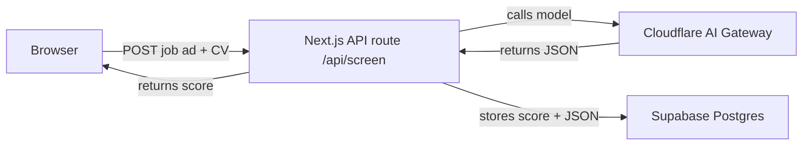

# HR Prescreen

Compares a job ad and a CV, scores the candidate, and stores only the result. Live on [https://hr-prescreen.vercel.app/](https://hr-prescreen.vercel.app/) 

## Problem

Recruiters prescreen CVs against job ads by hand. It is slow and inconsistent. This project automates the first pass: it returns a score, a summary, strengths, gaps, and interview questions, without storing the CV text.

## How it works

1. The recruiter pastes a job ad and a CV in the browser.
2. The Next.js API route validates the input with Zod (50 to 8000 characters per field).
3. The route calls the model through Cloudflare AI Gateway.
4. The model output is validated with Zod. On failure, the call is retried once.
5. The route stores only the score and the JSON result in Supabase. The CV text is never stored or logged.
6. The browser shows the score and the saved / not saved notice.

## Stack

- Next.js 16.4.6, App Router, TypeScript
- React 19.3.0
- Zod 4.6.7
- @supabase/supabase-js 2.109.0
- Vitest 4.1.12
- Playwright 1.65.1
- Tailwind CSS 4.3.3
- Cloudflare AI Gateway / Workers AI
- Supabase Postgres

## Design decisions and why

- Zod validation of model output with one retry. The model must return a strict JSON object. If it does not, `screenCandidate` retries once before failing.
- Service role key server-side only. `supabase.ts` builds the client with `SUPABASE_SERVICE_ROLE_KEY`. The client page imports nothing from `supabase.ts`.
- RLS on with no public policies. `supabase/schema.sql` enables row level security, revokes all access from `anon` and `authenticated`, and grants access only to `service_role`.
- Only results stored. The `screenings` table keeps `id`, `created_at`, `score`, and `result`. CV and job-ad text are never inserted or logged.
- Rate limiting. `rateLimit.ts` allows 5 requests per minute per IP. It is an in-memory map: it resets on redeploy and works per process. Trust `x-forwarded-for` only behind the hosting platform.
- Prompt-injection defence. The system prompt tells the model to treat the text between `<offre>` and `<cv>` as data and ignore instructions inside it. Closing tags in user text are escaped, and the rule is repeated at the end of the user message.

## Security notes

- `.env.local` is ignored and never committed. Copy `.env.example` and fill in the values locally.
- No `NEXT_PUBLIC_` variables. Secrets are read only in server files.
- Error messages shown to the user are generic. Internals go to `console.error` only.
- No CV or job-ad text is logged or stored.

## What the model got wrong

The first prompt version scored a CV 90/100 against an ad whose essential requirement (AngularJS 1.x) the CV only covered through a recent online course. The model also listed Docker as missing though it was on the CV, and listed autonomy and communication as strengths without evidence in the CV.

Fix: a stricter prompt with a scoring rubric, a rule to base everything on the CV text, and temperature 0.2. Score after the fix: 95/100.

## Bugs I hit and how I diagnosed them

- The AI Gateway required an extra authentication header (`cf-aig-authorization`). Added it to the request headers.
- A stale exported shell variable overrode `.env.local`. Next.js does not override existing environment variables, so the app used a wrong Supabase URL. Unset the shell variable.
- Postgres returned "permission denied" until I granted privileges to `service_role` and revoked default access from `anon` and `authenticated`. See `supabase/schema.sql`.
- A Playwright strict-mode violation because Next.js adds its own `role=alert` element. Fixed by asserting on `data-testid` instead.

## Testing and CI

- Unit tests with Vitest: `src/lib/schema.test.ts`, `src/lib/ai.test.ts`, `src/app/api/screen/route.test.ts`.
- End-to-end tests with Playwright using a mocked API, so no AI quota is spent: `e2e/screen.spec.ts`.
- GitHub Actions runs lint, tests, build, and e2e on push and pull request: `.github/workflows/ci.yml`.

## Limits and next steps

- Rate limit is in-memory per process and resets on redeploy.
- No user accounts yet.
- No human review step.
- No PDF upload.

## Run it locally

1. Copy `.env.example` to `.env.local` and fill in the values. Do not commit `.env.local`.
2. Run `npm install`.
3. Run `npm run dev`.
4. Open http://localhost:3000.

## Deploy

Deploy the Next.js application to your hosting platform. Set the environment variables from `.env.example`. Run `npm run build`.
