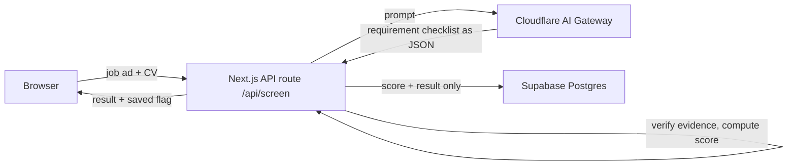

# HR Prescreen

Compares a job ad with a CV and returns a score, a requirement checklist, strengths, gaps and interview questions. It stores only the result, never the CV text.

Live demo: https://hr-prescreen.vercel.app/

**Use fake data only.** The output is advisory. It is not a hiring decision, and a human must review it.

## Problem

Prescreening a CV against a job ad is repetitive. This project tests how far a language model can help with a first pass, and how much of the judgement must stay in code. The main lesson: a model is good at extracting requirements and evidence, and bad at applying scoring rules.

## How it works

1. The user pastes a job ad and a CV (50 to 8000 characters each).
2. The API route rate-limits and validates the input with Zod.
3. The route asks the model, through Cloudflare AI Gateway, for a checklist: each requirement of the ad, whether it is essential, a status (`confirmed`, `partial`, `training`, `missing`), and a quote copied from the CV as evidence.
4. The output is validated with Zod. If it is invalid, the call is retried once.
5. Code checks that every evidence quote really appears in the CV. A quote that does not appear downgrades that item to `missing`.
6. Code computes the score and derives strengths and gaps from the verified checklist.
7. The route stores the score and the result in Supabase, then returns the result with a `saved` flag. The UI shows whether the result was saved.

## Scoring

The model does not produce a score. `src/lib/scoring.ts` does.

- Essential requirements weigh 3, others weigh 1.
- Points per status: confirmed 1, partial 0.5, training 0.4, missing 0.
- If an essential requirement is missing, the score is capped at 69.
- If an essential requirement is only partial or only learned in training, the score is capped at 75.
- If the model marks no requirement as essential, the score is capped at 85.

The weights and caps are my own choices. They are easy to change and covered by unit tests.

## Stack

Next.js (App Router) and TypeScript, Zod, Supabase Postgres, Cloudflare AI Gateway with Workers AI, Tailwind CSS, Vitest, Playwright, GitHub Actions, Vercel. Exact versions are in `package.json`. I tested with `@cf/meta/llama-3.3-70b-instruct-fp8-fast`; the model is set with the `CF_MODEL` variable.

## Design decisions

- **Rules in code, not in the prompt.** See the next section for why.
- **Evidence must exist in the CV.** Quotes are compared after lowercasing and collapsing whitespace. Anything shorter than 8 characters or not found is rejected.
- **Validate model output with Zod.** Retries happen only on network errors, 429, 5xx and invalid output. Other 4xx errors, such as a wrong token, are not retried.
- **Service role key stays on the server.** The browser never imports the Supabase client, and no variable has a `NEXT_PUBLIC_` prefix.
- **Row Level Security on, no public policies.** `supabase/schema.sql` revokes all access from `anon` and `authenticated` and grants access only to `service_role`.
- **Store only results.** The `screenings` table keeps `id`, `created_at`, `score` and `result`. CV and job-ad text are not stored or logged.
- **Rate limiting.** 5 requests per minute per IP, in memory. It is per instance and resets on redeploy, so it is only a partial defence.
- **Prompt-injection defences.** The prompt tells the model to treat the ad and CV as data. Closing tags in user text are escaped, and the rule is repeated after the user content. The evidence check also limits what an injected instruction can claim.

## What the model got wrong

I ran the same CV against the same ad in four versions. The CV covers AngularJS 1.x only through a recent online course, and AngularJS is the essential requirement of the ad.

| Version | Score |
| --- | --- |
| First prompt | 90 |
| Prompt with a scoring rubric, a rule to use only the CV text, temperature 0.2 | 95 |
| Long, detailed prompt with explicit caps | 85 |
| Model returns a checklist, code verifies evidence and computes the score | 68 |

The prompt rules say such a case is capped at 75. The model ignored its own cap three times and the score moved in the wrong direction once. Prompt instructions are suggestions, not guarantees. Moving the rules into code made the score follow them.

Other mistakes in earlier versions: it listed Docker as missing though it was on the CV, and it listed autonomy and communication as strengths without evidence.

## Known limits

- **The evidence check proves a quote exists, not that it supports the claim.** In my test, the model marked AngularJS as confirmed because a skills list mentions it, although the CV says it comes from a course. It also marked Docker and Kubernetes as confirmed with a quote that only mentions Docker. A stricter check would be needed.
- **Soft skills appear as requirements.** The model sometimes lists "autonomous" or "good communication" as requirements. They end up as `missing`, because a CV rarely proves them, which lowers scores unfairly.
- **Tested on few cases.** I tested mainly with one CV and one ad. I have not yet run a systematic prompt-injection test, an unrelated-CV test or a stability test with repeated runs.
- **Models can paraphrase when asked to quote.** A valid item can be downgraded to `missing`, so scores lean conservative.
- Prompt and output are in French only. There is no PDF upload, no user accounts and no human review step.
- CV text is sent to Cloudflare Workers AI for analysis. Do not use real personal data.

## Bugs I hit and how I diagnosed them

- **Gateway authentication.** The AI Gateway rejected requests until I added the `cf-aig-authorization` header. A direct call to the Workers AI API worked, which showed the token was valid and the gateway was the problem.
- **Stale shell variable.** After `source .env.local`, the exported variables overrode the file, because Next.js does not override variables that already exist. The app kept using a wrong Supabase URL until I unset them.
- **Database permissions.** Postgres returned "permission denied" until I granted privileges to `service_role`. I then revoked the default access from `anon` and `authenticated` and recorded everything in `supabase/schema.sql`.
- **Playwright strict mode.** Next.js adds its own `role="alert"` element, so a generic selector matched two elements. The test now uses a `data-testid`.
- **First Vercel deploy returned 502.** The route logs the upstream status code, and the runtime logs showed a 401 from the gateway.
- **Schema mismatch.** After I changed the prompt to return a checklist, validation still used the old schema, so every response failed. The route logs the failure reason, which made the cause easy to find.

## Testing and CI

- Unit tests with Vitest: `src/lib/schema.test.ts`, `src/lib/scoring.test.ts`, `src/lib/ai.test.ts`, `src/app/api/screen/route.test.ts`. Scoring tests need no model and cover the caps and the evidence check.
- End-to-end tests with Playwright in `e2e/screen.spec.ts`. The API is mocked, so no AI quota is spent.
- GitHub Actions runs lint, unit tests and e2e tests on every push and pull request (`.github/workflows/ci.yml`). It needs no secrets.

## Next steps

- A stricter evidence check, for example by asking the model to quote only from work experience and not from skills lists.
- Treat soft skills separately from technical requirements.
- A shared rate limiter such as Redis, because the in-memory one is per instance.
- Supabase Auth with per-user policies.
- PDF upload with server-side text extraction.
- A human review step before any result is used.

## Run it locally

1. Copy `.env.example` to `.env.local` and fill in the values. Never commit `.env.local`.
2. `npm install`
3. `npm run dev`, then open http://localhost:3000.
4. `npm run lint`, `npm run test`, `npm run e2e` and `npm run build` run the checks.

Required variables: `CF_ACCOUNT_ID`, `CF_GATEWAY_ID`, `CF_API_TOKEN`, `CF_AIG_TOKEN`, `CF_MODEL`, `SUPABASE_URL` (the project root, without `/rest/v1/`) and `SUPABASE_SERVICE_ROLE_KEY`.

If you export these variables in your terminal with `source`, run `unset` on them before you start the server again, or restart the terminal.

## Deploy (Vercel)

1. Push to GitHub and import the repository in Vercel.
2. Run `supabase/schema.sql` in the Supabase SQL editor.
3. Add the seven variables above. Store the tokens and the service role key as Secrets. Do not use a `NEXT_PUBLIC_` prefix.
4. Redeploy after any variable change. Vercel applies variables only to new deployments.